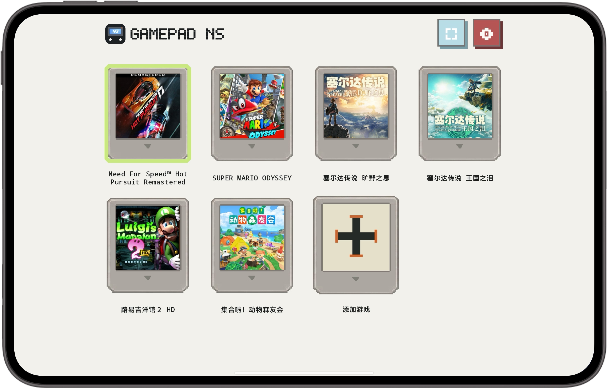

# GamePad NS

> **把 Switch 游戏带到 Android 平板的大屏上。**  
> Bring Switch gaming to the big screen of your Android tablet.

GamePad NS 游戏库截图 · GamePad NS library screenshot

<a href="https://gamefold.pages.dev">产品官网 / Official site</a> · <a href="https://github.com/lavande16/gamepad-ns-private/releases/tag/gamepad-ns-v1.8-10030-baseline">下载 V1.8 / Download</a>

## 当前基线 · Current baseline

| 项目 | 信息 |
|---|---|
| 版本 | **GamePad NS V1.8 · versionCode 10030** |
| Android 包名 | **com.gamepad.gamepad** |
| 下载 | [GitHub Release：V1.8 / 10030](https://github.com/lavande16/gamepad-ns-private/releases/tag/gamepad-ns-v1.8-10030-baseline) |
| 基线资料 | 仓库 baseline/ 与 Release 归档 |

## 让平板大屏与触控操作相配合 · A tablet-first gaming experience

- **根据屏幕配置调整操控区域：**方向键、摇杆和动作键随显示配置缩放，减少更改分辨率后控件偏位的情况。  
  **Controls that follow the screen:** the D-pad, sticks and action buttons scale with the display profile to stay aligned when the resolution changes.
- **可切换的显示模式：**V1.8 基线保留 4K 逻辑显示模式，并提供设备原生尺寸恢复；上一版 2304×1296 配置也继续保留。实际显示能力取决于设备。  
  **Flexible display profiles:** V1.8 keeps a 4K logical profile and native-size restore, while retaining the earlier 2304×1296 option. Actual display behavior depends on the device.
- **为长时间游玩保留熟悉的设置：**IPS、LSFG 与 T28 相关配置保留在基线中，帮助继续使用既有的画面与运行偏好。  
  **Keep familiar play settings:** IPS, LSFG and T28-related options remain available in the baseline for players who rely on those display and runtime preferences.
- **为横屏平板优化游戏与触控：**让游戏画面、按键布局与大屏显示配置配合起来，适合在 Android 平板上体验 Switch 游戏。  
  **A tablet-first landscape setup:** bring gameplay, touch controls and display profiles together for a Switch experience on an Android tablet.

本仓库保存 V1.8 / 10030 的源码与基线。游戏文件与第三方运行内容不随仓库提供；兼容性会因设备、游戏和运行配置而异。  
This repository preserves the V1.8 / 10030 source baseline. Game files and third-party runtime content are not included; compatibility varies with device, game and configuration.

## 从这里继续 · Continue from here

以 [baseline/](baseline/) 和 V1.8 Release 为当前基线。修改前请先核对其中的版本记录与默认配置，并保留设备原生显示值的恢复路径。  
Use [baseline/](baseline/) and the V1.8 Release as the starting point. Review the version record and defaults before changing them, and preserve the path for restoring the device's native display settings.

## GameFold 产品矩阵 · Product family

| 产品线 / Product | 仓库 / Repository | 官网 / Website |
|---|---|---|
| GameFold NS | [gamefold-ns-private](https://github.com/lavande16/gamefold-ns-private) | [GameFold](https://gamefold.pages.dev) |
| GamePad NS | [gamepad-ns-private](https://github.com/lavande16/gamepad-ns-private) | [GameFold](https://gamefold.pages.dev) |
